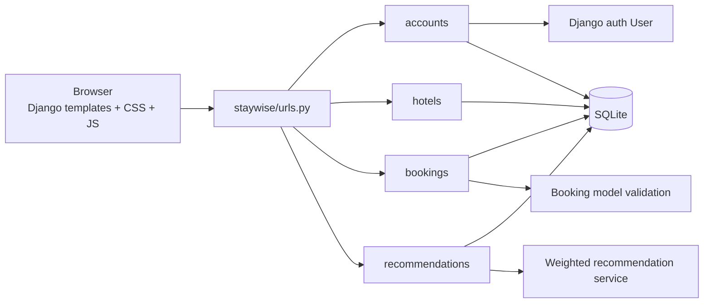
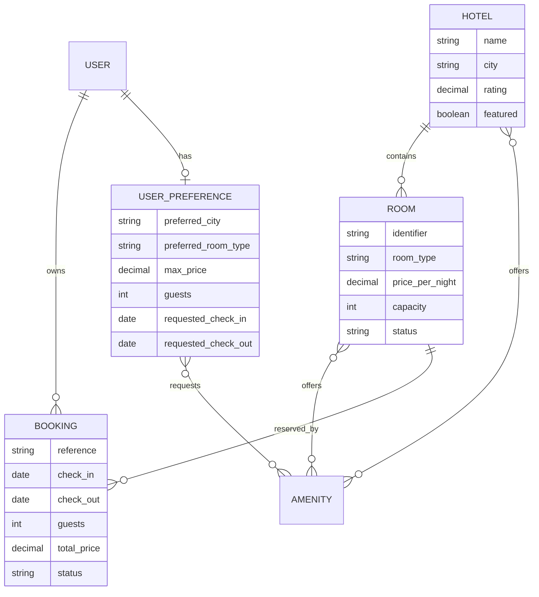
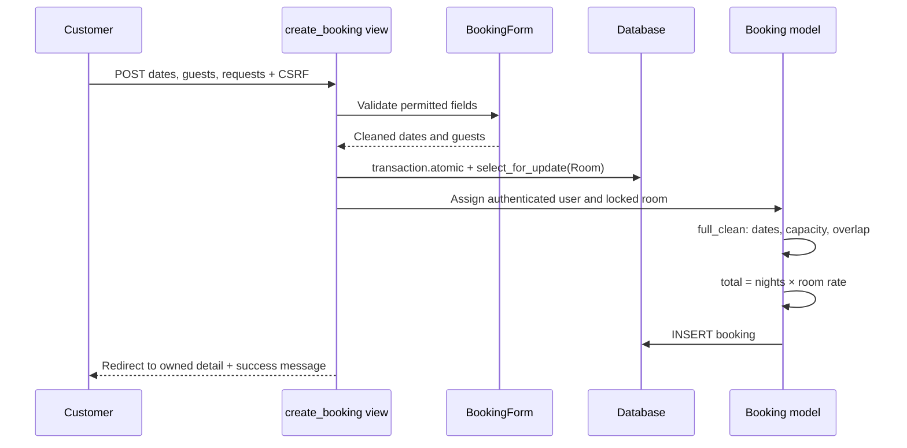
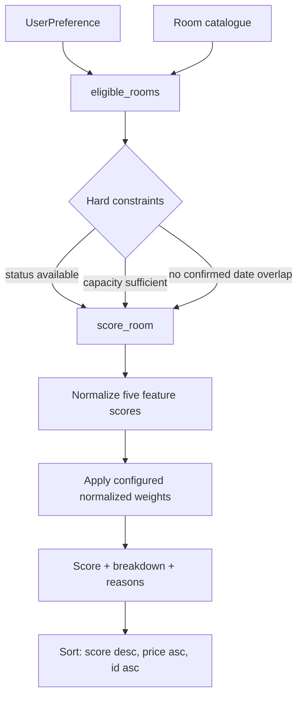

# Staywise Architecture

## System overview

Staywise is a server-rendered Django application. Django owns authentication, validation, database access, permissions, pricing, availability, and recommendation ranking. Bootstrap 5, project CSS, and vanilla JavaScript enhance the rendered HTML; JavaScript is never the authority for booking or account rules.

## Django applications

| Application | Responsibility |
| --- | --- |
| `accounts` | Registration, profile editing, username availability, customer dashboard, staff dashboard, and metric services. It uses Django's built-in `User`; `accounts/models.py` is intentionally empty. |
| `hotels` | Hotel, room, and amenity inventory; public discovery; search and availability filtering; demo-data command. |
| `bookings` | Booking creation, server pricing, overlap validation, history, ownership checks, and cancellation. |
| `recommendations` | One-to-one customer preferences, deterministic scoring, hard-constraint filtering, explanations, and evaluation command. |

## Models and relationships

`Room.hotel` cascades when a hotel is deleted. `Booking.room` uses `PROTECT`, preventing deletion of inventory referenced by booking history. User deletion cascades to that user's bookings and preference record. Room identifiers are globally unique and also covered by a hotel/identifier database constraint.

## Request-response flow

1. `staywise/urls.py` delegates the request to an application URL configuration.
2. A view constructs a Django form, checks authentication/permissions, and builds an ORM query.
3. Forms validate user-controlled fields. Models and services enforce business rules that must also hold outside an HTML request.
4. The ORM reads or writes SQLite.
5. The view renders a template or redirects after a successful POST.
6. Django messages survive the redirect and `includes/messages.html` renders them as fixed toasts.
7. `static/js/site.js` provides progressive enhancement such as the signup wizard, toast lifecycle, date assistance, and responsive sidebar.

## Authentication and permission boundaries

- Django authentication URLs provide login, logout, and password-reset token flows under `/accounts/`.
- `accounts.views.signup` uses `SignUpForm`, creates the `User`, authenticates it, and redirects to preferences.
- `login_required` protects dashboards, preferences, recommendations, booking creation/history/detail/cancellation, and profile editing.
- `staff_member_required` protects the staff dashboard. Django Admin applies its own staff and model-permission checks.
- Booking detail and cancellation queries include `user=request.user`; another customer's primary key returns 404 rather than disclosing the record.
- Cancellation is POST-only and CSRF middleware remains enabled.

## Booking and availability flow

Overlap uses `existing.check_in < requested.check_out AND existing.check_out > requested.check_in` for confirmed bookings only. Therefore adjacent stays are allowed and cancelled bookings do not block inventory. Search and recommendations use the same interval logic. A room's inventory status is separate from date availability; a booking never permanently changes `Room.status`.

The transaction and second model validation reduce the concurrency window. SQLite ignores effective row-level `SELECT ... FOR UPDATE` locking, so this is not a complete concurrent-write guarantee. PostgreSQL is recommended for production; a database exclusion constraint could further strengthen interval protection.

## Recommendation architecture

The service is in `recommendations/services.py`, separate from views and templates. It does not train a model and must be described as a deterministic weighted content-based recommender. See [RECOMMENDATION_ENGINE.md](RECOMMENDATION_ENGINE.md) for the formula.

## Frontend architecture

- `templates/base.html` provides metadata, public navigation, messages, content, footer, Bootstrap, and project assets.
- `templates/dashboard_base.html` adds the authenticated sidebar/topbar shell.
- Application templates extend one of those bases.
- `templates/includes/` contains reusable fields, navigation, messages, room cards, booking summaries, pagination, and footer.
- `static/css/site.css` contains Mint & Seafoam tokens and page components. `static/css/toasts.css` loads last to isolate toast positioning from legacy rules. `static/css/admin.css` brands Django Admin.
- `static/js/site.js` is progressive enhancement. Server rendering and validation remain usable without it, except that the signup fields appear as a single submitted Django form whose visual steps are managed in JavaScript.
- Uploaded images use `MEDIA_ROOT`; built-in assets use `static/images`. Broken room images are replaced with an accessible local visual fallback.

## Design decisions and trade-offs

- **Server rendering:** simpler deployment and strong alignment with the required Django stack; less client-side state than a SPA.
- **Django forms plus model validation:** forms provide usable field errors; model validation protects non-form writes and recalculates booking totals.
- **Vanilla toast manager:** Bootstrap is available, but a small idempotent manager fits Django messages without adding a dependency or a second notification framework.
- **SQLite:** appropriate for a final-year demonstration and local setup, but limited for concurrent booking writes.
- **External UI CDNs:** Bootstrap, Bootstrap Icons, Google Fonts, and Chart.js currently require network access. Core database and server behavior does not depend on them, and charts show a fallback if Chart.js fails.
