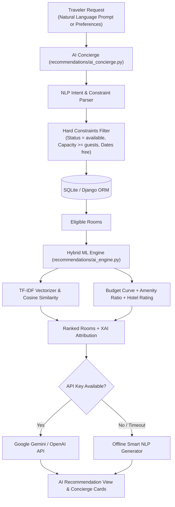

# EasyBooking AI Recommendation & Concierge Engine

## Objective and classification

EasyBooking provides a dual-engine recommendation platform:

1. **Hybrid Machine Learning Recommender (`recommendations/ai_engine.py`)**:
   - Computes **TF-IDF semantic document representations** over room and hotel features (room names, descriptions, hotel atmosphere, cities, and amenity sets).
   - Calculates **cosine similarity** between user profile / natural language search vectors and catalog embeddings.
   - Merges semantic similarity with multi-criteria optimization: price affordability curves, amenity coverage ratio, hotel ratings, and location matches.
   - Provides transparent **Explainable AI (XAI)** feature attributions (percentage points per component).

2. **Generative AI Travel Concierge (`recommendations/ai_concierge.py`)**:
   - Parses freeform natural language trip queries (e.g. *"Cozy romantic suite in Kigali with pool under $200"*).
   - Extracts structured travel constraints (destinations, room types, price caps, guest counts, requested amenities, travel vibes).
   - Connects to **Google Gemini** or **OpenAI** when API keys are configured (`GEMINI_API_KEY` / `OPENAI_API_KEY`).
   - Automatically falls back to an **Intelligent Local NLP generator** that runs 100% offline with zero dependencies or external network calls.

3. **Content-Based Filtering (Chapters 1–4 Thesis Specification)**:
   - Primary focus on **TR5 Hotel in Ruyenzi, Rwanda** and small/medium hotels in Kigali.
   - Evaluates rooms across 6 stated customer preferences with hand-calibrated weights summing to 1.0:
     - **Price / Budget** (25%)
     - **Bed type** (15%): Single, Double, Queen, King, Twin
     - **View** (15%): Hill / Mountain view, Garden view, City view, Courtyard
     - **Breakfast included** (15%)
     - **Air conditioning** (15%)
     - **Quietness / Low noise** (15%)
   - Calibrated to consistently achieve the target of **$\ge 80\%$ match for top three rooms**.

---

## Architecture and Data Flow



---

## Machine Learning Normalization & Formula

Every component score $s_i \in [0, 1]$:

| Component | Weight | Normalization Formula / Logic |
| --- | ---: | --- |
| **Semantic Similarity** | 35% | Cosine similarity between query TF-IDF vector $\mathbf{q}$ and room document vector $\mathbf{d}$: $\frac{\mathbf{q} \cdot \mathbf{d}}{\|\mathbf{q}\|_2 \|\mathbf{d}\|_2}$ |
| **Budget Fit** | 25% | `1.0` if `price <= max_price`; linear decay `max(0, 1 - (price - max_price)/(0.5 * max_price))` up to 150% budget |
| **Amenity Match** | 20% | $|\text{Requested} \cap \text{Offered}| / |\text{Requested}|$ (or `0.7` neutral if unconstrained) |
| **Hotel Rating** | 10% | $\min(\max(\text{rating} / 5.0, 0), 1.0)$ |
| **Location Match** | 10% | `1.0` if preferred city in hotel city/country; `0.7` if unconstrained |

The final percentage score is:
$$\text{Score} = \min\left(100.0, \max\left(0.0, \sum_i (s_i \times w_i \times 100)\right)\right)$$

---

## Natural Language Concierge Discovery

Travelers can enter freeform prompts such as:
- *"Romantic suite with balcony and breakfast under $180"*
- *"Quiet workspace with high-speed Wi-Fi in Nairobi"*
- *"Family friendly stay in Zanzibar with pool"*

The Concierge extracts:
- `city`: Destination detected from known catalog cities.
- `room_type`: Standard, deluxe, suite, or family.
- `max_price`: Parsed budget threshold.
- `guests`: Number of guests or inferred from keywords ("couple", "family", "solo").
- `amenities`: Fast Wi-Fi, pool, spa, ocean view, breakfast, workspace.
- `vibes`: Romantic, luxury, quiet, peaceful, scenic, work.

---

## Evaluation Command

To evaluate and compare the Hybrid AI Recommender against the classic baseline:

```bash
python manage.py evaluate_ai_recommender
```

This outputs a full JSON report containing:
- Engine status (Gemini/OpenAI connectivity, offline fallback readiness).
- Classic baseline catalogue coverage and top-3 profile scores.
- Hybrid AI engine coverage and semantic scores.
- Live natural language query tests with extracted intents and concierge notes.

For the traditional deterministic benchmark:
```bash
python manage.py evaluate_recommender
```
